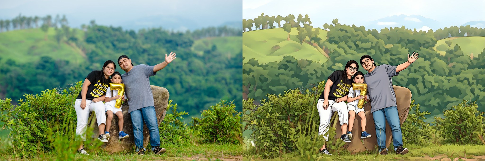
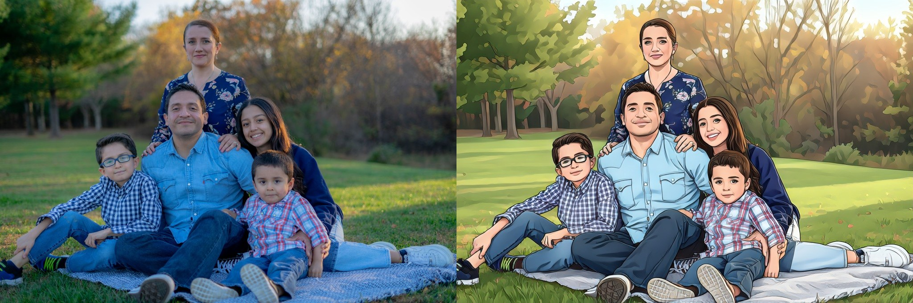
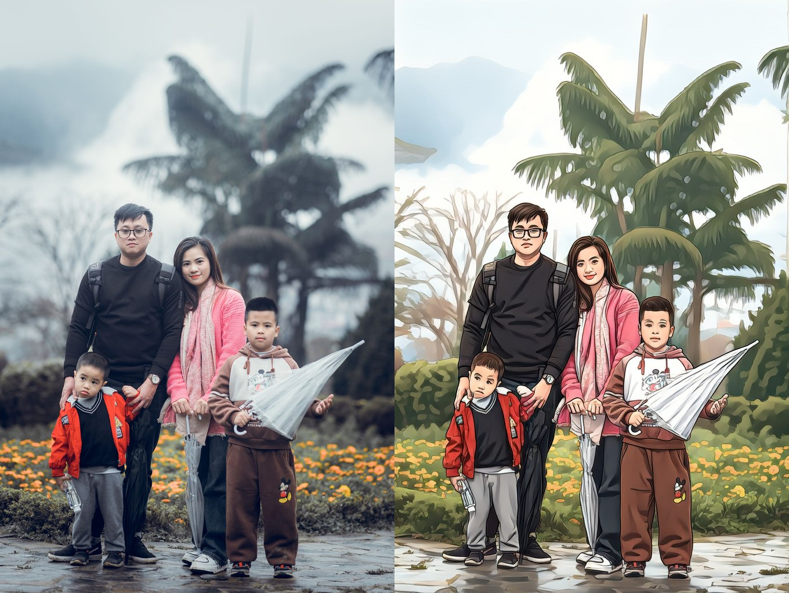
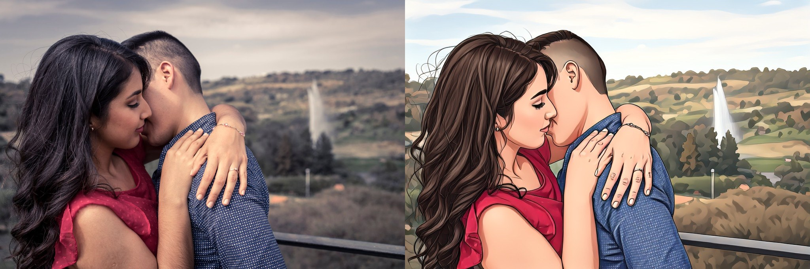
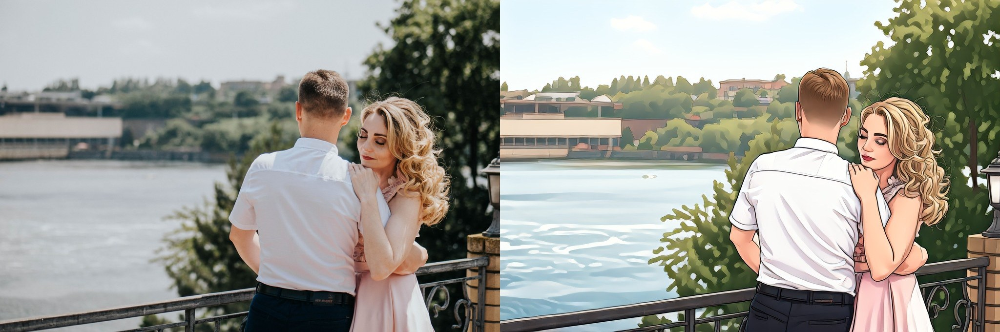
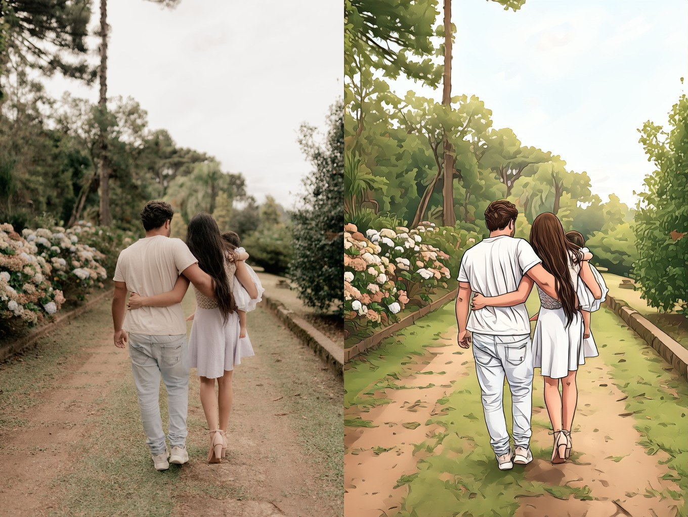

<p align="center">
  <h1 align="center">TurboLite — Photo to Illustration on CPU</h1>
  <p align="center">
    <strong>Turn any photo into stunning cartoon art in ~16 seconds. No GPU. No cloud. No subscription.</strong>
  </p>
  <p align="center">
    <a href="https://www.thearifoffice.com">Website</a> &nbsp;|&nbsp;
    <a href="#-results">Results</a> &nbsp;|&nbsp;
    <a href="#-get-access">Get Access</a> &nbsp;|&nbsp;
    <a href="#-benchmarks">Benchmarks</a>
  </p>
</p>

---

**TurboLite** is a lightweight, CPU-only photo-to-illustration engine that transforms ordinary photographs into beautiful, hand-drawn-style cartoon illustrations — in seconds, on any machine.

No expensive GPU. No monthly API subscription. No large language model or vision model. Just a single Python script, three tiny dependencies, and results that look like they were drawn by a professional illustrator.

> **This is a preview repo.** The inference code and sample results are public so you can see exactly what TurboLite produces. **Model weights are distributed separately** — visit [thearifoffice.com](https://www.thearifoffice.com) or [open an issue](../../issues) to request access.

---

## ✦ Results

Every image below is a real output. Left: original photo. Right: TurboLite output. No cherry-picking, no post-processing, no manual touch-ups.

### Family & Group Portraits

<p align="center">
  
  <br><sub>1024 × 680 — processed in 20.4 s</sub>
</p>

<p align="center">
  
  <br><sub>1024 × 680 — processed in 17.7 s</sub>
</p>

<p align="center">
  
  <br><sub>680 × 1024 — processed in 17.9 s</sub>
</p>

### Couples & Portraits

<p align="center">
  
  <br><sub>1024 × 680 — processed in 16.3 s</sub>
</p>

<p align="center">
  
  <br><sub>1024 × 680 — processed in 17.4 s</sub>
</p>

### Full Scene

<p align="center">
  
  <br><sub>680 × 1024 — processed in 18.2 s</sub>
</p>

---

## ⚡ Why TurboLite?

| | TurboLite | Typical AI Art Tools |
|---|---|---|
| **GPU required** | No — runs on any CPU | Yes — needs CUDA GPU |
| **Cloud / API** | No — 100% offline | Yes — sends your photos to a server |
| **Subscription** | No — one-time setup | $10–50/month |
| **Large model download** | ~3.3 GB total | 6–12 GB+ (Stable Diffusion, etc.) |
| **Speed (1024px)** | ~16 seconds | 30–90+ seconds (even on GPU) |
| **Privacy** | Your photos never leave your machine | Photos uploaded to third-party servers |
| **Dependencies** | 3 Python packages | CUDA, PyTorch, dozens of packages |
| **LLM / VLM needed** | No | Often requires vision-language models |

### Key Features

- **CPU-only inference** — Works on Intel, AMD, any x86 processor. No NVIDIA GPU, no CUDA, no ROCm
- **Blazing fast** — 16–20 seconds per photo at 1024px on a mid-range CPU (Intel i5-10400)
- **Lightweight** — Only 3 dependencies: `openvino`, `numpy`, `pillow`
- **Batch processing** — Point it at a folder, process hundreds of photos unattended
- **High fidelity** — Distilled from a FLUX-quality model; virtually indistinguishable from the full-size original (LPIPS difference: 0.034)
- **Production quality** — Handles portraits, landscapes, groups, close-ups, indoor/outdoor scenes
- **Privacy-first** — Everything runs locally. Your photos never leave your computer

---

## 🚀 Quick Start

### 1. Install dependencies

```bash
pip install -r requirements.txt
```

That's it. Three packages: `openvino`, `numpy`, `pillow`.

### 2. Get model weights

Model weights are not included in this repository. Visit **[thearifoffice.com](https://www.thearifoffice.com)** to request access.

Once you have the weights, place them in the `weights/` folder:

```
weights/
├── small_encoder.xml
├── small_encoder.bin     (22 MB)
├── unet.xml
├── unet.bin              (3.3 GB)
├── small_decoder.xml
├── small_decoder.bin     (36 MB)
└── scaling_factor.txt
```

### 3. Run

```bash
# Single photo
python run_cpu_lite.py --input photo.jpg

# Folder of photos with side-by-side comparison output
python run_cpu_lite.py --input my_photos/ --out results/ --threads 6 --compare
```

### Options

| Flag | Default | Description |
|---|---|---|
| `--input` | *(required)* | A single image file or a folder of images |
| `--out` | `results` | Output folder |
| `--long_side` | `1024` | Longer side in pixels. Use `768` for faster processing |
| `--threads` | `4` | CPU threads. Set to your number of physical cores for best speed |
| `--compare` | off | Save original and result side-by-side |

### Python API

```python
from PIL import Image
from run_cpu_lite import LiteCartoonifier

cartoonifier = LiteCartoonifier(threads=4)        # load once
result = cartoonifier(Image.open("photo.jpg"))     # use many times
result.save("cartoon.jpg")
```

---

## 📊 Benchmarks

Tested on **Intel Core i5-10400** (6 cores, 12 threads) — a standard desktop CPU.

### Speed

| Image Size | Time per Photo | Encoder | UNet | Decoder |
|---|---|---|---|---|
| 1024 × 680 | **16–20 s** | 0.5 s | 12–14 s | 1.5 s |
| 680 × 1024 | **17–18 s** | 0.5 s | 12–13 s | 1.4 s |

> The first photo of each new aspect ratio takes 2–3 s longer (one-time model reshape). Subsequent photos of the same size are faster.

### Memory Usage

| Configuration | Peak RAM |
|---|---|
| TurboLite (this version) | **~8 GB** |
| Full model (PyTorch) | ~11 GB |
| Full model (OpenVINO) | ~13 GB |

### Quality vs Full Model

Measured on 99 held-out test images against FLUX ground-truth targets:

| Metric | Full Model | TurboLite |
|---|---|---|
| LPIPS (perceptual distance) | 0.2197 | **0.2198** |
| L1 (pixel distance) | 0.2008 | **0.2008** |

> **TurboLite is perceptually identical to the full model.** The LPIPS difference between TurboLite and the full model is just **0.034** — imperceptible to the human eye.

---

## 🏗️ Architecture

TurboLite uses a distilled architecture for maximum CPU efficiency:

| Component | Size | Role |
|---|---|---|
| **Small Encoder** | 22 MB | Compresses the input photo to a latent representation |
| **UNet** | 3.3 GB | The core diffusion network — performs the style transfer in one step |
| **Small Decoder** | 36 MB | Reconstructs the final illustration from the latent + original photo |

The encoder and decoder are compact student networks, distilled from a much larger VAE to match its output within LPIPS 0.034. The UNet performs the actual artistic transformation in a **single forward pass** — no iterative denoising, no scheduler, no classifier-free guidance.

---

## 🤝 Get Access

**TurboLite is a product of [The Arif Office](https://www.thearifoffice.com).**

This repository contains the full inference code and sample results. Model weights are provided separately to authorized users.

**To get access:**

1. Visit **[thearifoffice.com](https://www.thearifoffice.com)**
2. Or [open an issue](../../issues) on this repo describing your use case
3. Or reach out directly to the author

**Licensing options available:**
- Personal / non-commercial use
- Commercial / enterprise licensing
- Integration & API partnerships

---

## 📋 Requirements

- **Python** 3.8+
- **OS:** Linux, macOS, or Windows
- **RAM:** 8 GB minimum
- **CPU:** Any modern x86 processor (Intel or AMD)
- **GPU:** Not required
- **Dependencies:** `openvino`, `numpy`, `pillow`

---

## 🌟 Star This Repo

If TurboLite catches your eye, **give it a star** — it helps others discover CPU-friendly AI art tools and motivates continued development.

**[Follow the author](../../)** for updates on new styles, speed improvements, and upcoming features.

---

<p align="center">
  <strong>Built by <a href="https://www.thearifoffice.com">The Arif Office</a></strong>
  <br>
  Fast AI art that respects your hardware, your privacy, and your wallet.
</p>

---

<sub>
<strong>Keywords:</strong> photo to cartoon, photo to illustration, AI art CPU, image stylization, pix2pix turbo, OpenVINO inference, CPU image processing, offline AI art generator, no GPU image generation, cartoon filter AI, photo to anime, portrait illustration AI, lightweight AI model, edge AI art, local AI image processing, privacy-first AI, batch photo cartoonizer, photo to drawing AI, neural style transfer CPU, fast image to cartoon converter
</sub>
